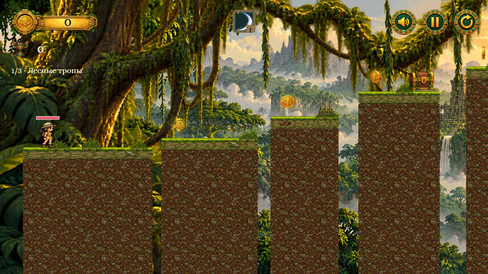
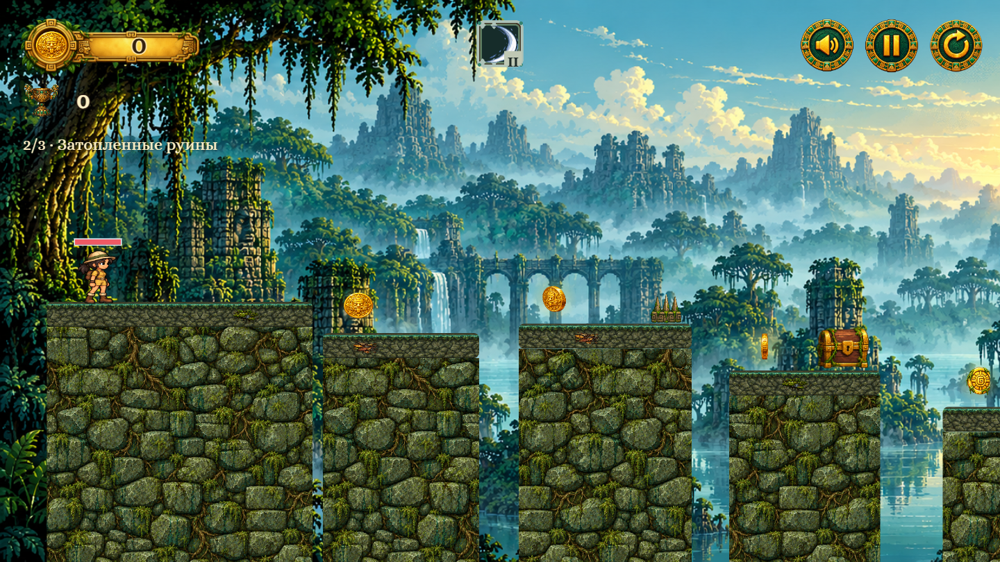
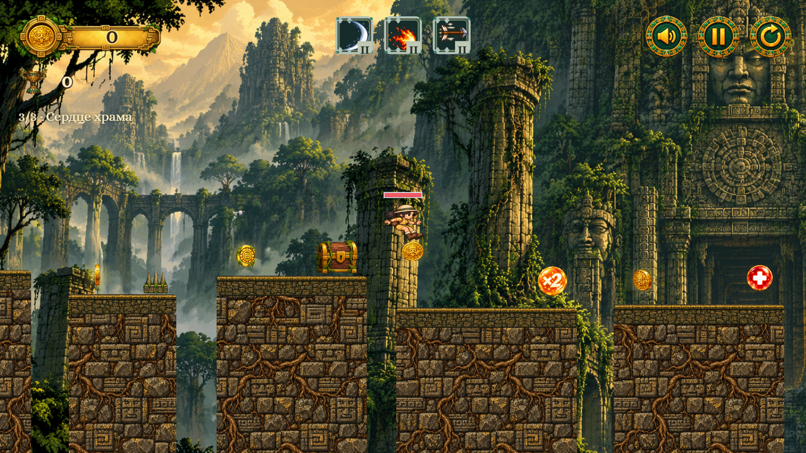

# Тайна древнего храма

Браузерный платформер на Canvas: три этапа, случайные маршруты, карты способностей и босс в финале. Для разработки откройте проект через локальный сервер (`python -m http.server 8000` → [localhost:8000](http://localhost:8000)).

## Как играть

| Действие | Клавиатура | Телефон |
| --- | --- | --- |
| Движение и прыжок | A/D или ←/→; W, ↑ или Space | Экранные кнопки |
| Пауза, музыка, повтор этапа | Esc, M, кнопка сверху | Кнопки сверху |
| Выбор карты | ←/→, затем удерживать W, ↑ или Space 0,5 с | Удерживать карту 0,5 с |
| Смена карт | Удерживать ↓ 0,5 с при наличии смены | Кнопка смены карт |

Соберите **65% монет** на первом этапе и **70%** на остальных, чтобы открыть портал. Финального босса можно обойти: победа над ним даёт дополнительные монеты, но для выхода важен только процент сбора. Войдите в светящуюся арку: первые два портала ведут к следующему этапу, третий — к экрану победы. Между этапами сохраняются умения и бонусы, восстанавливается 1 HP. При поражении повторяется тот же этап с прежним маршрутом и сборкой на входе.

## Этапы и баланс

| Этап | Окружение | Платформы | Противники | Лечение |
| --- | --- | ---: | --- | ---: |
| Лесные тропы | Зелёный лес, мшистые площадки | 18 | 3–4 HP, редкие приёмы | 2 пузыря |
| Затопленные руины | Бирюзовый туман, влажный камень | 24 | 4–6 HP, больше приёмов | 3 пузыря |
| Сердце храма | Древний фасад, резная кладка | 32 | 4–6 HP и босс 16 HP | 4 пузыря |

Герой начинает с мечом. Если к следующему этапу выпало мало боевых улучшений, здоровье врагов снижается на 1 HP, босса — до 8 HP. Пузыри лечения доступны и без карты лечения; они остаются на месте, пока здоровье полное. Пузыри скорости и урона действуют временно. Усиление **×2 урона** встречается только на последнем этапе: на первых двух обычные враги не погибают от одного удара даже с картой урона.

| Автоматическое умение | Интервал | Условие |
| --- | ---: | --- |
| Меч, лук | 3 с | Меч ждёт врага рядом; точность лука: 65/85/100% по уровням |
| Огненный шар, лёд | 6 с / 8 с | Ждут цель; лёд замораживает |
| Лечение, компаньон | 12 с / 5 с | Лечение при потере HP; компаньон атакует со 2-го уровня |

Шансы редкости обычных наград: **обычная 55%**, **редкая 30%**, **эпическая 12%**, **легендарная 3%**. В обычном сундуке с шансом **53%** одно из трёх предложений заменяется шуточной суперспособностью без эффекта; с учётом адских сундуков это примерно каждый второй сундук. Ещё не полученные умения получают приоритет. Карту урона можно взять один раз, скорость ограничена удвоением.

## Структура кода

| Часть | Что делает |
| --- | --- |
| [`js/game/LevelStages.js`](js/game/LevelStages.js), [`LevelGenerator.js`](js/game/LevelGenerator.js) | Параметры этапов и построение маршрута по seed |
| [`js/game/Game.js`](js/game/Game.js), [`js/game/features/`](js/game/features/) | Игровой цикл, переходы, бой, карты и бонусы |
| [`js/render/`](js/render/), [`js/ui/`](js/ui/) | Отрисовка мира и интерфейса |
| [`assets/json/game.json`](assets/json/game.json), [`texts.json`](assets/json/texts.json) | Числа баланса, пути к ресурсам и тексты |
| [`assets/`](assets/) | Графика, анимации и звук |

Проверки: `node --test tests/*.test.mjs`. Для публикации: `node scripts/build.mjs`; готовый сайт находится в `dist/`. Сборка использует закреплённую версию esbuild, объединяет модули с tree shaking и копирует только используемые игровые ресурсы. Исходные спрайт-листы и файлы для генерации остаются в проекте, но не попадают в `dist/`. Аудит: `node scripts/audit-assets.mjs` и `python scripts/audit-image-sizes.py`.
